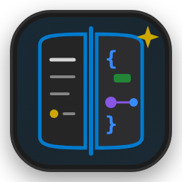
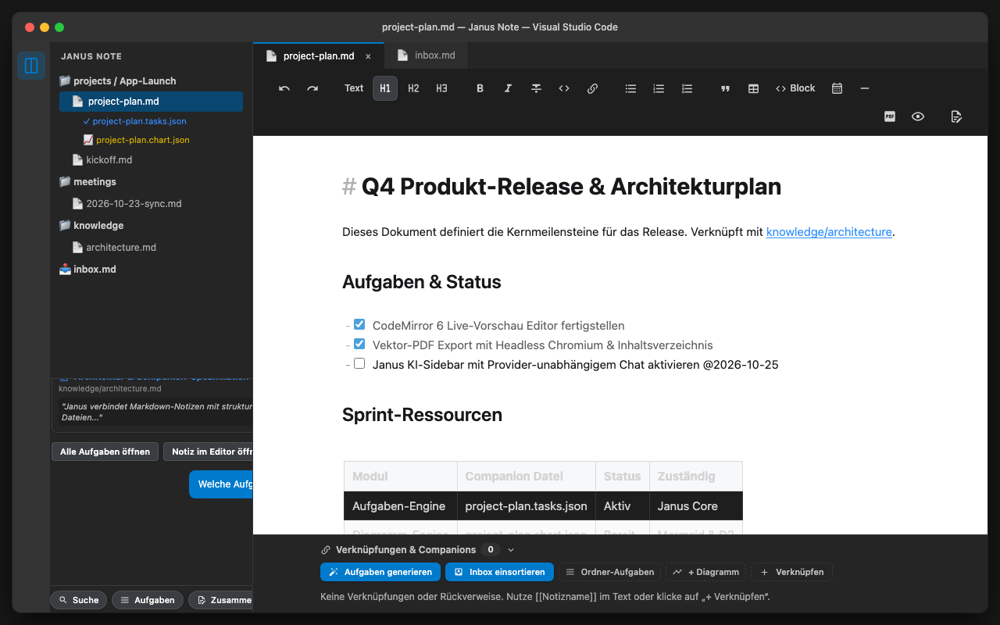
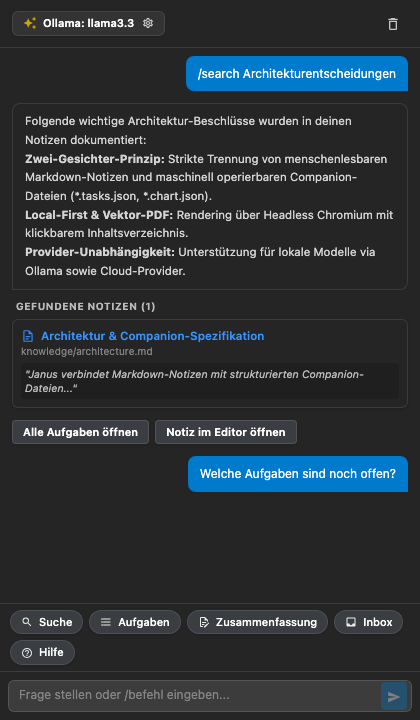
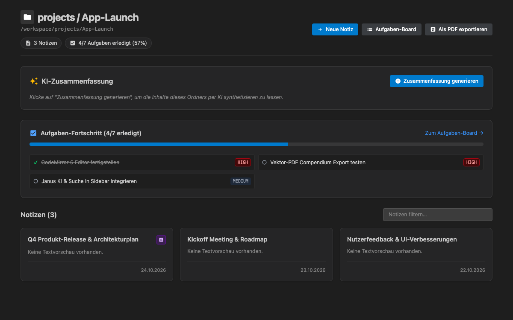
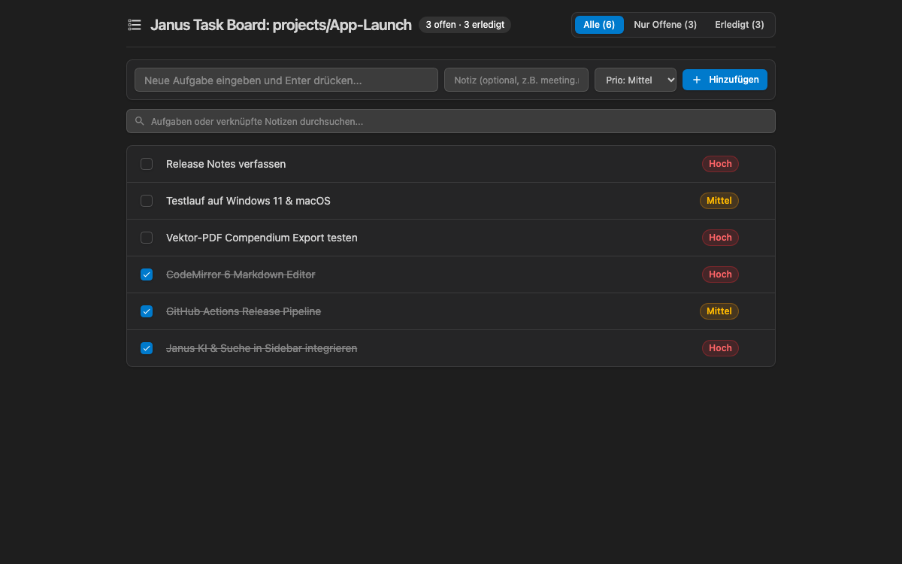
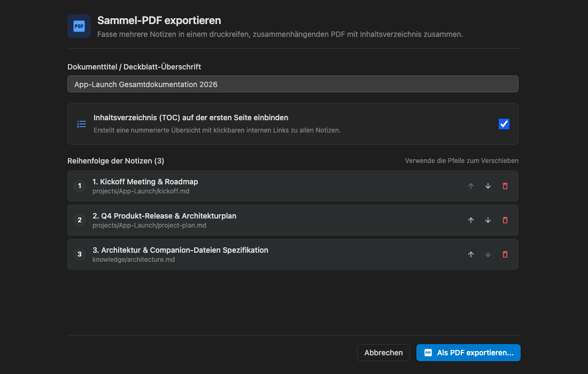

# Janus Note

<p align="center">
  
</p>

<p align="center">
  <strong>Human Markdown Notes &amp; Machine-Operable Companion Files with AI Assistance for Visual Studio Code</strong>
</p>

<p align="center">
  <a href="https://github.com/marc2016/janus-note-vs/actions/workflows/ci.yml"></a>
  <a href="https://github.com/marc2016/janus-note-vs/releases"></a>
  
  
</p>

<p align="center">
  
</p>

---

## 📖 Das Janus-Konzept: Zwei Perspektiven, ein Workspace

Herkömmliche Notiz-Tools stehen vor einem Dilemma: Entweder sind Notizen reine Textdateien für Menschen, die für KI-Agenten schwer strukturiert zu manipulieren sind – oder sie werden in proprietären Datenbanken abgelegt, wodurch die Transparenz und Portabilität verloren gehen.

**Janus Note** löst dieses Problem durch das **Zwei-Gesichter-Prinzip (Janus)**:
1. **Menschliche Perspektive (Human):** Klare, ästhetische Markdown-Notizen (`*.md`), die Sie im gewohnten Fluss schreiben, lesen und versionieren.
2. **Maschinelle Perspektive (Machine / Agent):** Schema-validierte Companion-Dateien (`*.tasks.json`, `*.chart.json`), die direkt an die Notiz gekoppelt sind. KI-Agenten und strukturierte UI-Tools können Aufgaben und Diagramme sicher aktualisieren, ohne den Fließtext Ihrer Notiz zu beschädigen.

Alle Daten liegen als offene, transparente Dateien in Ihrem lokalen Git-Repository – **100% Local-First**, ohne Vendor-Lock-in.

---

## ✨ Features

### ✍️ Moderner CodeMirror 6 Markdown-Editor
- **Live-Vorschau mit Syntax-Umschaltung:** Blenden Sie Markdown-Syntax (wie `**`, `#`, `>`) wahlweise ein oder aus (Auge-Symbol).
- **Inline-Formatierungs-Toolbar:** Schneller Zugriff auf Fett, Kursiv, Durchgestrichen, Überschriften (H1–H3), Zitate, Listen und Tabellen direkt am Cursor.
- **Interaktive Task-Checklisten:** Aufgaben (`- [ ]`, `- [x]`) können direkt im Texteditor angeklickt und abgehakt werden.
- **Date-Picker Popover:** Fügen Sie Datumsangaben (`@2026-10-24`) mit einem Klick über einen interaktiven Kalender ein.
- **Wikilinks & Inline-Linking:** Schnelle Verknüpfung via `[[notiz]]` mit Autovervollständigung, Klick-Navigation und Zeilen-Highlighting.
- **Verknüpfungs- & Companion-Footer:** Zeigt am Fuß jeder Notiz verknüpfte Companion-Dateien (Tasks, Diagramme) und Backlinks an.

---

### 🤖 Janus KI & Suche in der Sidebar
Ein vollwertiger, provider-unabhängiger KI-Chat direkt in der VS Code Aktivitätsleiste unter Ihrem Notizen-Baum.

<p align="center">
  
</p>

- **Provider-Unabhängig:** Nutzen Sie lokale Sprachmodelle via **Ollama** (z. B. `llama3.3`, `qwen2.5`) für 100% private Notizen – oder verbinden Sie **Google Gemini**, **OpenAI**, **Anthropic Claude** oder eigene Custom AI Endpoints.
- **1-Klick Quick-Command Chips:** Schneller Zugriff auf `/search`, `/tasks`, `/summarize`, `/inbox` und `/help` über klickbare Buttons oberhalb des Eingabefelds.
- **Semantische Workspace-Suche (RAG):** Findet relevante Notizen und Aufgaben anhand von Kontext und Begriffen und stellt sie der KI bereit.
- **Interaktive Quellkarten:** Jede Information nennt die Quelle; ein Klick auf die Karte öffnet die passende Notiz direkt im Editor.
- **Kontextuelle Aktionsbuttons:** Antworten bieten direkte Aktionen wie *„Alle Aufgaben öffnen“*, *„Ordner-Aufgaben öffnen“* oder *„Inbox mit KI einsortieren“*.

---

### 📁 Ordner-Übersicht & Multi-Selection Dashboard
Erhalten Sie sofortigen Überblick über einzelne Ordner oder mehrere markierte Notizen.

<p align="center">
  
</p>

- **KI-Zusammenfassung auf Knopfdruck:** Fasst alle Notizen eines Ordners automatisch mit dem konfigurierten Modell prägnant zusammen.
- **Statistiken & Metriken:** Anzahl der Notizen, offene Aufgaben und Gesamterledigungsgrad im Ordner.
- **Notizkarten:** Interaktive Karten aller Notizen mit Erstellungszeitpunkt, Snippet und Schnellstart für Aufgaben und Diagramme.
- **Schnellaktionen:** Neue Notiz im Ordner anlegen, Aufgaben-Board öffnen oder als PDF exportieren.

---

### ☑️ Interaktives Aufgaben-Board & Global Tasks
Strukturierte Aufgabenverwaltung ohne manuelle Textfrickelei.

<p align="center">
  
</p>

- **Visuelles Kanban-Board:** Verwalten Sie Aufgaben in den Spalten *Zu erledigen*, *In Bearbeitung* und *Erledigt*.
- **Companion-Integration:** Aufgaben werden in schema-validierten `*.tasks.json`-Dateien synchronisiert und im Editor gespiegelt.
- **Prioritäten & Fälligkeiten:** Farbcodierte Prioritäts-Tags (`HIGH`, `MEDIUM`, `LOW`) und Datums-Filter.
- **Globales Workspace Task-Board:** Aggregiert alle Aufgaben über sämtliche Projektordner hinweg in einer zentralen Übersicht (`janus-tasks:///all`).

---

### 📄 Vektor-PDF Export (Einzeldokument & Notizensammlung)
Erstellen Sie saubere, hochauflösende PDF-Dokumente für Kunden, Meetings oder die Archivierung.

<p align="center">
  
</p>

- **Vektorscharfe Headless-Chromium-Engine:** Nutzt lokale Browser (Google Chrome, Microsoft Edge, Brave, Chromium) für pixelgenaue Typografie.
- **Notizensammlungen & Compendien:** Exportieren Sie ganze Ordner oder mehrere markierte Notizen als ein zusammenhängendes PDF-Buch.
- **Interaktives Konfigurations-Webview:**
  - Reihenfolge der Notizen per *Nach oben* / *Nach unten* individuell bestimmen.
  - Optionales, anklickbares **Inhaltsverzeichnis** auf dem Deckblatt mit internen PDF-Sprungmarken (`#note-X`).
- **Druckhygiene & SVG-Grafiken:** Saubere Seitenumbrüche vor jeder Notiz (`page-break-before: always`), Umbruchschutz für Tabellen und Codeblöcke sowie Vektor-Rendering von Mermaid-Diagrammen.

---

### 📊 Diagramme & Datenvisualisierung
- **Mermaid-Unterstützung:** Zeichnen Sie Flussdiagramme, Sequenzdiagramme und Architekturpläne in `*.chart.json` oder direkt in Markdown-Codeblöcken.
- **D3-Diagramme:** Interaktive Liniendiagramme, Balkendiagramme, Donut-Charts und Netzwerkgraphen.
- **Theme-Adaptive Farben:** Diagramme passen sich automatisch dem aktiven VS Code Theme (Dark/Light) an.

---

### 📅 Kalender-Monatsansicht & Tagesdetails
- **Monatsübersicht:** Zeigt alle Deadlines, Aufgaben und Notizen mit Datumsbezug im Kalenderraster an.
- **Tagesdetails-Sidebar:** Ein Klick auf einen Tag öffnet die Tagesansicht (`janus.calendarDayDetailsView`) mit allen anstehenden Aufgaben dieses Tages.

---

## 🚀 Erste Schritte

### Installation

#### Über GitHub Releases (VSIX)
1. Laden Sie die neueste `.vsix`-Datei aus den [GitHub Releases](https://github.com/marc2016/janus-note-vs/releases) herunter.
2. Öffnen Sie in Visual Studio Code die Erweiterungsansicht (`Strg+Umschalt+X` / `Cmd+Shift+X`).
3. Klicken Sie oben rechts auf das `...`-Menü und wählen Sie **Aus VSIX installieren...** (*Install from VSIX...*).
4. Wählen Sie die heruntergeladene Datei aus.

---

### Initialisierung & Ordnerstruktur

1. Klicken Sie in der Aktivitätsleiste auf das **Janus Note**-Symbol.
2. Wenn Ihr Workspace noch keine Notizen enthält, klicken Sie in der Willkommensansicht auf **Notizen initialisieren** (`janus.initNotesRoot`).
3. Janus erstellt automatisch folgende empfohlene Struktur:
   ```text
   📁 mein-workspace/
   ├── 📄 inbox.md              # Schnelle, unsortierte Gedanken & Notizen
   ├── 📁 meetings/             # Besprechungsnotizen & Protokolle
   ├── 📁 projects/             # Projektpläne & Dokumentation
   └── 📁 knowledge/            # Wissenssammlungen & Architekturdokumente
   ```
4. **Vorhandene Ordner verknüpfen:** Über den Befehl `janus.addLinkedFolder` können Sie beliebige externe Ordner in Ihre Notizen-Sidebar einbinden, ohne Ihre Projektstruktur verändern zu müssen.

---

## ⌨️ Befehle (Command Palette)

Alle Befehle können über die VS Code Befehlspalette (`Strg+Umschalt+P` / `Cmd+Shift+P`) aufgerufen werden:

| Befehl | Identifier | Beschreibung |
|---|---|---|
| `Janus: Als PDF exportieren...` | `janus.exportNoteToPdf` | Exportiert die aktive Markdown-Notiz als Vektor-PDF. |
| `Janus: Ordner als Sammel-PDF exportieren...` | `janus.exportFolderToPdf` | Öffnet das interaktive Dialogfenster zum Export mehrerer Notizen mit Inhaltsverzeichnis. |
| `Janus: KI & Suche fokussieren` | `janus.focusChatView` | Fokussiert die Sidebar-Chat- und Suchansicht. |
| `Janus: Aufgaben-Board öffnen` | `janus.openAllTasks` | Öffnet das globale Kanban-Board aller Workspace-Aufgaben. |
| `Janus: Kalender öffnen` | `janus.openCalendarMonth` | Öffnet die interaktive Monatskalenderansicht. |
| `Janus: Inbox mit KI einsortieren` | `janus.sortInbox` | Analysiert `inbox.md` und sortiert Einträge thematisch in passende Ordner ein. |
| `Janus: Aufgaben mit KI aus Notiz generieren` | `janus.generateTasksFromNote` | Extrahiert konkrete Todos aus Fließtext und aktualisiert die Companion-Datei. |
| `Janus: Einstellungen öffnen` | `janus.openSettings` | Öffnet das grafische Janus-Einstellungs-Panel für KI-Modelle und Pfade. |
| `Janus: Ordner verknüpfen...` | `janus.addLinkedFolder` | Verknüpft einen bestehenden Ordner im Dateisystem mit der Notizen-Sidebar. |
| `Janus: Notizen-Ordner initialisieren` | `janus.initNotesRoot` | Erstellt die Standardstruktur (`inbox.md`, `meetings`, `projects`, `knowledge`). |

---

## ⚙️ Konfiguration

Passen Sie Janus in den VS Code Einstellungen (`Cmd+,` / `Ctrl+,` → Suche nach `janus`) oder über das Janus Settings Webview an:

| Einstellung | Typ | Standard | Beschreibung |
|---|---|---|---|
| `janus.notesRoot` | `string` | `""` | Relativer Pfad zum primären Notizenverzeichnis (z. B. `notes`). Wenn leer, wird der Workspace-Root genutzt. |
| `janus.includeFolders` | `string[]` | `[]` | Zusätzliche Ordnerpfade, die in der Notizen-Sidebar angezeigt werden. |
| `janus.ai.provider` | `string` | `"vscode-lm"` | Aktiver KI-Provider: `vscode-lm`, `ollama`, `gemini`, `openai`, `anthropic` oder `custom`. |
| `janus.ai.ollama.model` | `string` | `"llama3.3"` | Modellname für lokale Ollama-Inferenz (z. B. `llama3.3`, `qwen2.5`, `mistral`). |
| `janus.ai.ollama.endpoint` | `string` | `"http://localhost:11434"` | URL des lokalen Ollama-Servers. |
| `janus.ai.gemini.model` | `string` | `"gemini-2.5-flash"` | Modellname für Google Gemini API. |
| `janus.ai.openai.model` | `string` | `"gpt-4o"` | Modellname für OpenAI API. |
| `janus.ai.anthropic.model` | `string` | `"claude-3-7-sonnet-latest"` | Modellname für Anthropic Claude API. |
| `janus.export.browserPath` | `string` | `""` | Optionaler benutzerdefinierter Pfad zur Chromium-Binärdatei für den PDF-Export. |

---

## 🔒 Datenschutz & Sicherheit

- **100% Lokale Daten:** Ihre Notizen und Companion-Dateien verbleiben vollständig auf Ihrem Rechner. Es gibt keine Telemetrie und keinen zentralen Cloud-Zwang.
- **Lokale KI mit Ollama:** Bei Auswahl von Ollama laufen alle Suchen, Zusammenfassungen und Task-Generierungen offline auf Ihrer eigenen Hardware.
- **Sichere Schlüsselverwaltung:** API-Schlüssel für Cloud-Provider (OpenAI, Gemini, Anthropic) werden über die sichere Betriebssystem-Schlüsselverwaltung (`vscode.SecretStorage` / macOS Keychain, Windows Credential Manager) hinterlegt und niemals im Klartext oder in `.git` gespeichert.

---

## 🛠️ Entwicklung & Build

### Voraussetzungen
- Node.js 20+
- npm 10+

### Entwicklungsumgebung einrichten
```bash
# Abhängigkeiten installieren
npm install

# TypeScript Type-Check ausführen
npm run compile

# Unit-Tests starten (Vitest)
npm test

# Extension & Webview-Bundles bauen (esbuild & Tailwind CSS v4)
npm run build

# Watch-Modus für die Entwicklung
npm run watch
```

### Release erstellen
Janus Note enthält ein interaktives Release-Skript:
```bash
./release.sh
# oder mit direkter Version:
./release.sh 0.2.0
```
Das Skript führt Type-Checks und Tests aus, baut die Bundles, aktualisiert `package.json`, erstellt den Git-Tag und stößt den GitHub Actions Workflow an, der das VSIX-Paket baut und an das GitHub Release anhängt.

---

## 📄 Lizenz

Dieses Projekt ist lizenziert unter der [MIT License](LICENSE.txt).
