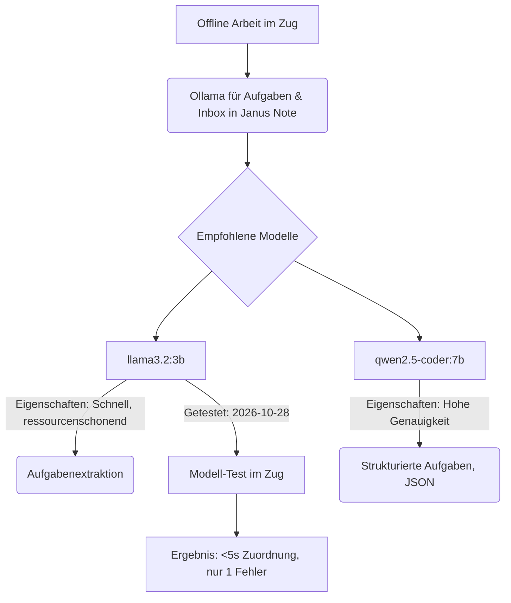

# Lokale Ollama-Modelle

Wenn man unterwegs im Zug ohne Internet arbeitet, eignet sich `llama3.2` oder `qwen2.5-coder` über Ollama perfekt für die lokale Aufgaben-Extraktion und Inbox-Sortierung in Janus Note.

#ki #offline

## Empfohlene Modelle

- `llama3.2:3b`: Schnell und ressourcenschonend für Aufgabenextraktion.
- `qwen2.5-coder:7b`: Hohe Genauigkeit für strukturierte Aufgaben und JSON.

## Modell-Test im Zug (2026-10-28)

Auf der Fahrt nach Köln `llama3.2:3b` offline für die Inbox-Sortierung getestet: Zuordnung in unter 5 Sekunden, nur ein Block landete im falschen Ordner.

