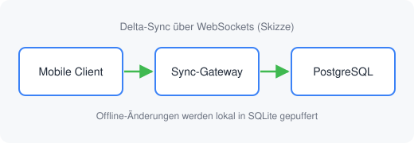
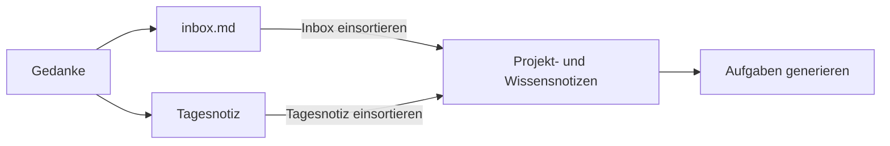

# Janus Note – Beispiel-Workspace & Übersicht

Willkommen im **Janus Note** Test-Workspace (`sample/`)! Hier kannst du alle Funktionen direkt ausprobieren:

## 1. Gefüllte Inbox testen
Öffne die [[inbox]] – dort warten bereits mehrere verschiedene Gedanken und Abschnitte:
- Klicke unten in der Fußleiste auf **„Inbox einsortieren"**, um die Abschnitte per KI in bestehende Notizen (wie [[app-launch]] oder [[kickoff]]) anzuhängen oder als neue Notiz anzulegen.
- Standardmäßig erscheint zuerst die **Vorschau** (QuickPick), in der du einzelne Vorschläge an- oder abwählen kannst.

## 2. Aufgaben per KI aus Notizen generieren
Öffne [[app-launch]], [[kickoff]] oder [[sprint-review]] und klicke unten in der Fußleiste auf **„Aufgaben generieren"**:
- Die KI liest die offenen Punkte aus dem Text und trägt neue Aufgaben ohne Duplikate in die `tasks.json` des jeweiligen Ordners ein.

## 3. Verknüpfungen, Backlinks & Diagramme
- **Projekte**: [[app-launch]], [[architektur]] (inkl. Mermaid-Diagramm), [[kickoff]], [[design-system]]
- **Alias-Link**: [[Systemdesign]] führt ebenfalls zur Architektur-Notiz – sie trägt im Frontmatter `aliases: [Systemdesign, Backend-Architektur]`. Tippe `[[Backend` und die Autovervollständigung schlägt sie über den Alias vor.
- **Meetings**: [[sprint-review]]
- **Wissensbasis**: [[ki-prompts]], [[ollama-models]]

## 4. Verweise mit Zeilenmarkierung testen
Klicke auf die folgenden Links, um das automatische Springen zur Zeile und die Hervorhebung zu testen:
- **Sprung in Markdown-Notiz**: [[app-launch:9]] (springt zu Zeile 9 der Meilensteine in `app-launch.md` und markiert die Zeile)
- **Sprung in Markdown-Abschnitt**: [Architektur-Sync:9](projects/App-Launch/architektur.md:9) (springt zu Zeile 9 in `architektur.md`)
- **Sprung in Code-/Projektdatei**: [package.json:20](package.json:20) (öffnet `package.json` bei Zeile 20 und markiert sie)
- **Backlinks in der Fußleiste**: Öffne z. B. [[architektur]] und sieh dir die Fußleiste an. Dort zeigt das Backlink-Badge die genaue Zeilennummer, woher der Verweis stammt (z. B. `app-launch :3`). Ein Klick führt direkt dorthin!

## 5. Tagesnotizen
- Klicke in der Titelleiste der Notizen-Ansicht auf **„Tagesnotiz öffnen"**, um die Notiz für heute in `journal/` zu öffnen oder anzulegen. Neue Tagesnotizen nutzen die Vorlage `.templates/tagesnotiz.md`.
- Öffne [[journal/2026-10-29]]: Sie hat drei Abschnitte, die noch nicht einsortiert sind. Klicke in der Fußleiste auf **„Tagesnotiz einsortieren"**. Die Abschnitte werden in passende Notizen *kopiert*, und unter jedem erscheint ein Link `-> [[…]]`, wohin er ging.
- [[journal/2026-10-28]] zeigt das Ergebnis: Der Abschnitt „Modell-Test im Zug" wurde schon nach [[ollama-models]] einsortiert und wird beim nächsten Durchlauf übersprungen.
- Im Kalender erscheinen beide Tagesnotizen an ihrem Tag. In den Tagesdetails gibt es den Button **„Tagesnotiz öffnen"** bzw. **„Tagesnotiz anlegen"**.

## 6. Vorlagen
- Unter **„Neue Notiz"** kannst du nach dem Namen eine Vorlage wählen: `meeting`, `projekt` oder `tagesnotiz` aus `.templates/`. Platzhalter wie `{{title}}`, `{{date}}`, `{{date:DD.MM.YYYY}}`, `{{weekday}}` und `{{time}}` werden beim Anlegen ausgefüllt.
- Über **„Vorlagen bearbeiten"** im Menü der Notizen-Ansicht öffnest du eine Vorlage oder legst eine neue an.

## 7. Umbenennen mit Link-Aktualisierung
- Benenne z. B. [[design-system]] in der Notizen-Ansicht um: Alle Links darauf (etwa in [[kickoff]] und [[sprint-review]]) werden automatisch angepasst.

## 8. Bilder einfügen
- Kopiere einen Screenshot und füge ihn mit `Cmd+V` in eine Notiz ein, oder ziehe Bilder aus dem Finder hinein. Sie landen im Ordner `assets/` neben der Notiz, und der Link wird automatisch eingefügt.
- Das Bild erscheint direkt unter seiner Zeile. Setzt du den Cursor auf die Zeile, siehst du den Markdown-Link zum Bearbeiten:



## 9. Mermaid-Diagramme
- ```` ```mermaid ````-Blöcke erscheinen im Editor direkt als Diagramm. Mit dem Schalter **„Code"** oben rechts siehst du den Quelltext und darunter eine Live-Vorschau, **„Diagramm"** klappt den Code wieder ein.
- Ein neues Diagramm legst du mit `/chart` an. Ein Sequenzdiagramm findest du in [[architektur]].



---

## 10. KI direkt im Editor
- **Diagramm ändern:** Klicke bei einem Diagramm oben rechts auf **„KI"** und beschreibe im Chat, was sich ändern soll (z. B. „Füge nach Notizen einen Schritt Kalender hinzu"). Mit **„Übernehmen"** landet der Vorschlag im Diagramm, `Cmd+Z` macht es rückgängig.
- **Neues Diagramm:** Tippe `/ki-diagramm` in eine leere Zeile. Die KI kennt den Abschnitt, in dem du gerade bist – schreib im Chat z. B. „Mach daraus ein Ablaufdiagramm".
- **Text markieren:** Markiere den folgenden Absatz. Im kleinen Popup kannst du ihn **zusammenfassen** (mit „Darunter einfügen" als Callout) oder direkt ein **Diagramm erstellen** lassen. Ein Beispiel für ein so erzeugtes Diagramm findest du in [[ollama-models]].

Zum Ausprobieren: Neue Gedanken landen zuerst in der Inbox oder in der Tagesnotiz. Einmal am Tag sortiert die KI sie in Projekt- und Wissensnotizen ein; in der Tagesnotiz bleibt dabei ein Link stehen, wohin jeder Abschnitt kopiert wurde. Aus den einsortierten Notizen lassen sich anschließend Aufgaben generieren, die im Kalender und in der Aufgabenübersicht erscheinen. Wiederkehrende Strukturen wie Meetings oder Projekte startest du mit einer Vorlage, und Diagramme halten die wichtigsten Abläufe fest.
