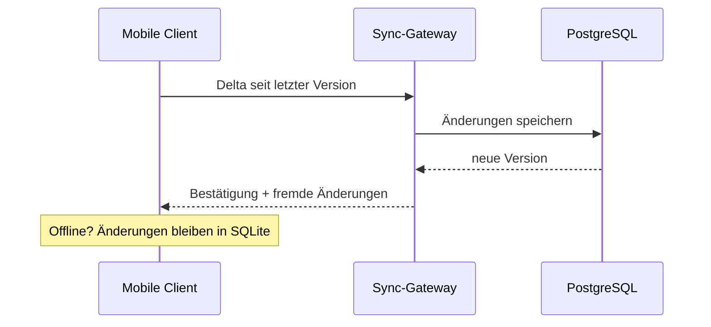

# System-Architektur (App-Launch)

Diese Notiz beschreibt die Backend- und Sync-Architektur für den [[app-launch]].
Über das **Diagramm-Badge** unten in der Fußleiste kannst du das zugehörige Mermaid-Architekturdiagramm (`architektur.chart.json`) öffnen.

## Komponenten

1. **Mobile Client**: Offline-First Speicherung mit lokaler SQLite-Datenbank.
2. **Sync-Gateway**: Delta-Synchronisation über WebSockets.
3. **KI-Service**: Anbindung über [[ki-prompts]] zur automatischen Klassifizierung.

## Sync-Ablauf

## Offene Architektur-Aufgaben

- Rate-Limiting am API-Gateway auf 120 Requests pro Minute pro Nutzer begrenzen.
- Automatisiertes Backup-Skript für die PostgreSQL-Hauptdatenbank einrichten.
